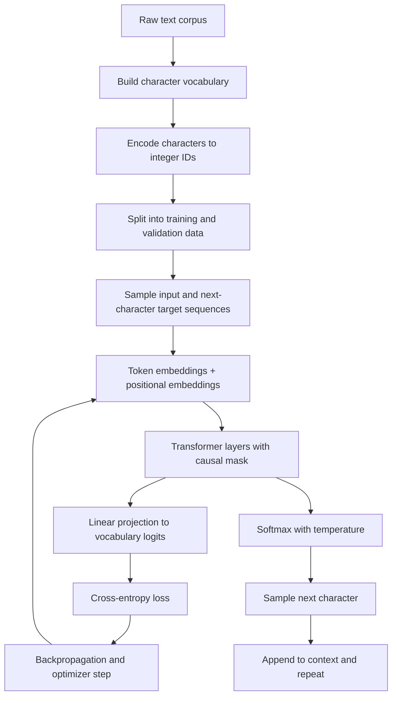

# TinyLLM 

A small GPT-style language model built from scratch in PyTorch. It is trained on a single short novel-length text and generates new text one character at a time.

TinyLLM is a learning and experimentation project. It is not a production LLM and not a chat assistant: it predicts the next character of a text, nothing more.

## Table of Contents

- [Overview](#overview)
- [Architecture](#architecture)
- [Model Configuration](#model-configuration)
- [Dataset](#dataset)
- [Training](#training)
- [Text Generation CLI](#text-generation-cli)
- [Results and Limitations](#results-and-limitations)
- [Checkpoint](#checkpoint)
- [Project Structure](#project-structure)
- [Technologies](#technologies)
- [Roadmap](#roadmap)
- [License and Acknowledgements](#license-and-acknowledgements)

## Overview

The model learns statistical patterns in a text corpus by repeatedly predicting the next character given the characters before it. After training, it can continue a prompt by sampling one character at a time, feeding each new character back in as context.

What the project contains:

- Character-level tokenization with a vocabulary built from the training text.
- Token and positional embeddings.
- A Transformer stack with a causal attention mask.
- A training loop with periodic training and validation loss evaluation.
- A saved checkpoint holding the weights, vocabulary and model configuration.
- A terminal CLI that streams generated text character by character.

## Architecture

### Data flow



The upper half is training. The lower branch is generation from a trained checkpoint.

### Why a Transformer encoder with a causal mask

The model is built on PyTorch's `nn.TransformerEncoder` rather than a dedicated GPT decoder class. An encoder layer is self-attention plus a feed-forward block, which is exactly the body of a GPT-style model. On its own, though, an encoder lets every position attend to every other position, including future ones. That would let the model cheat at next-character prediction.

The causal mask fixes this: position *t* may only attend to positions up to *t*. With the mask applied, the computation is autoregressive and behaves like a GPT decoder. Without it, it would not.

### Components

| Component | Purpose |
| --- | --- |
| Token embeddings | Map each character ID to a learned vector. |
| Positional embeddings | Give the model information about order, since attention alone has no notion of position. |
| Multi-head self-attention | Lets each position gather information from earlier positions; multiple heads can focus on different patterns at once. |
| Feed-forward layers | Per-position nonlinear transformation that adds capacity after attention. |
| Residual connections and layer normalization | Built into PyTorch's Transformer encoder layer; they stabilize training of stacked layers. |
| Dropout | Randomly zeroes activations during training to reduce overfitting. Disabled at inference. |
| Causal mask | Blocks attention to future positions so training matches generation. |
| Output projection | Linear layer turning each hidden state into one logit per vocabulary character. |
| Cross-entropy loss | Measures how much probability the model assigned to the true next character. Lower is better. |

## Model Configuration

| Parameter | Value |
| --- | ---: |
| Vocabulary size | 68 |
| Embedding dimension | 128 |
| Attention heads | 4 |
| Transformer layers | 3 |
| Context length | 128 characters |
| Dropout | 0.1 |
| Parameters | about 628,932 |

What these control:

- **Embedding dimension** sets the width of every hidden representation. Larger values increase capacity and cost.
- **Heads** split attention into parallel subspaces; the embedding dimension must be divisible by the head count.
- **Layers** set depth. More layers allow more complex patterns but train slower and overfit more easily on small data.
- **Context length** is how many previous characters the model can see. During generation, only the most recent 128 characters condition each prediction.
- **Dropout** trades training fit for regularization.

## Dataset

The training corpus is `data/data.txt`, about 28,612 characters of *The Wood of the Dead* by Algernon Blackwood.

How it becomes training data:

1. Every distinct character in the text becomes a vocabulary entry (68 in total), with mappings from character to ID and back.
2. The whole text is encoded as a sequence of integer IDs.
3. The data is divided into a training portion and a held-out validation portion.
4. Training examples are windows of consecutive characters. The target for each position is simply the next character, so the target window is the input window shifted by one.

Character-level tokenization is simple and well suited to learning exercises, since there is no tokenizer to build. The cost is longer sequences and typically more data required than with subword tokenization.

Around 28 thousand characters is very small. The model has little to learn from, which limits generalization and shows up as repetitive or incoherent generations.

## Training

Run training from the project root:

```powershell
uv run python trainer/train.py
```

Run `uv run python trainer/train.py --help` to see the available options. The training run recorded below used 5000 iterations with evaluation every 250 steps.

During training, loss is evaluated on both splits at regular intervals:

- **Training loss** is the cross-entropy on data the model is learning from.
- **Validation loss** is the cross-entropy on held-out text. It is the better indicator of how well the model generalizes.

A loss near 4.2 at the start is roughly what a model guessing uniformly among 68 characters would score (ln 68 is about 4.22).

### Recorded run

These numbers come from one training run. They are not a guaranteed result.

| Step | Training loss | Validation loss |
| ---: | ------------: | --------------: |
| 1 | 4.3285 | 4.3255 |
| 250 | 2.3584 | 2.3654 |
| 500 | 2.2834 | 2.2810 |
| 1000 | 1.9946 | 2.0012 |
| 2000 | 1.4594 | 1.7096 |
| 2500 | 1.2567 | 1.6476 |
| 3000 | 1.0696 | 1.6385 |
| 4000 | 0.7563 | 1.7487 |
| 5000 | 0.5123 | 1.8532 |

Training loss fell steadily through the run. Validation loss reached its lowest observed value around step 3000 and then rose. This is overfitting: the model keeps fitting the training text, including details specific to it, without improving on held-out text. With a corpus this small, the model begins memorizing early.

The checkpoint at the end of a run reflects the model's final state. Do not assume it is the best-validation checkpoint.

## Text Generation CLI

The CLI loads the saved checkpoint, rebuilds the model from the stored configuration, and generates text autoregressively: it encodes the prompt, predicts a distribution over the next character, samples one, appends it to the context, and repeats.

Interactive mode:

```powershell
uv run python tests/testllm.py
```

Single prompt:

```powershell
uv run python tests/testllm.py --prompt "The old house"
```

With options:

```powershell
uv run python tests/testllm.py --prompt "The old house" --tokens 300 --temperature 0.8
```

| Option | Default | Description |
| --- | ---: | --- |
| `--prompt` | none | Starting text. If given, the script generates once and exits. Without it, interactive mode starts. |
| `--tokens` | 300 | Maximum number of new characters to generate. Must be at least 1. |
| `--temperature` | 0.8 | Sampling temperature. Must be greater than 0. |

In interactive mode, type a prompt and press Enter. Type `q`, `quit`, `e` or `exit` to leave. Ctrl+C interrupts a generation.

The interface uses [Rich](https://github.com/Textualize/rich) for colored output. Generated text is streamed to the terminal one character at a time. The script uses the GPU when CUDA is available in the installed PyTorch build, and the CPU otherwise.

### Temperature

The model's output logits are divided by the temperature before the softmax.

- Lower values sharpen the distribution, making output more predictable and repetitive.
- Higher values flatten it, making output more varied and more error-prone.

Temperature changes how the model samples, not what it has learned. It cannot fix a weakly trained model.

### Prompt handling

- Characters in the prompt that are not in the training vocabulary are silently dropped.
- If no prompt character is in the vocabulary, nothing is generated and a message is shown.
- Sampling is plain multinomial sampling from the temperature-scaled distribution. There is no top-k or top-p filtering.
- There is no conversation history; every prompt is processed independently.

## Results and Limitations

The model picks up local character patterns and some of the style of its source text. Expect malformed words, ungrammatical sentences, repetition and passages that do not make sense. For example, output after the prompt `dslf` looks like prose in rhythm and punctuation but is not coherent.

Limitations:

- Very small training corpus (tens of thousands of characters).
- Character-level tokenization rather than subword tokens.
- Small model and a 128-character context window.
- Overfitting is visible in the recorded training run.
- No instruction tuning or conversational fine-tuning.
- No retrieval of external knowledge.
- No memory between prompts.
- No guarantee that generated text is factual. Output is fiction-like text, not information.

A prompt like "Who are you?" does not turn this into an assistant. The model continues the characters it is given in the style of a short literary text.

## Checkpoint

The inference script loads the checkpoint from `MODEL_FILE`, defined in [`trainer/train.py`](trainer/train.py). The expected file is `model/mini_gpt.pt`.

The checkpoint stores:

- `model_state_dict`: the trained weights.
- `config`: the model hyperparameters used to rebuild the architecture.
- `vocab_size`, `stoi` and `itos`: the vocabulary size and the character-to-ID and ID-to-character mappings.

To generate, the CLI constructs `TinyGPT` from `vocab_size` and `config`, loads the weights, and switches the model to evaluation mode. The checkpoint is loaded with `weights_only=True`.

If the checkpoint is missing, the CLI exits with a message asking you to run training first.

Model files can be large. Depending on your repository policy, consider Git LFS or excluding the checkpoint from version control.

## Project Structure

```text
TinyLLM/
├── data/
│   └── data.txt          # Training corpus
├── model/
│   └── mini_gpt.pt       # Saved checkpoint (created by training)
├── trainer/
│   ├── __init__.py
│   └── train.py          # Model definition, data prep, training loop
├── tests/
│   └── testllm.py        # Generation CLI
├── pyproject.toml        # Project and dependency configuration
├── uv.lock               # Locked dependency versions
└── README.md
```

## Technologies

- Python
- PyTorch
- Transformer architecture (`nn.TransformerEncoder` with a causal mask)
- CUDA, optional, depending on the installed PyTorch build
- [uv](https://docs.astral.sh/uv/) for environment and dependency management
- [Rich](https://github.com/Textualize/rich) for the terminal interface

## Roadmap

- [ ] Expand and diversify the training corpus.
- [ ] Save and restore the best validation checkpoint.
- [ ] Add loss curves and training metrics.
- [ ] Add deterministic seeds and reproducible configurations.
- [ ] Improve checkpoint management and support resuming training.
- [ ] Experiment with subword tokenization.
- [ ] Make model and training hyperparameters configurable from the command line.
- [ ] Compare generation quality at different temperatures.
- [ ] Add automated tests for checkpoint loading and text generation.
- [ ] Experiment with larger models and longer context windows.

## License and Acknowledgements

No license has been specified for this project's code yet. Check the repository before redistributing it.

The training text is *The Wood of the Dead* by Algernon Blackwood. Its copyright status has not been verified here, so confirm it before redistributing the corpus.

This project follows the general approach popularized by character-level GPT tutorials, implemented here with PyTorch's built-in Transformer modules.