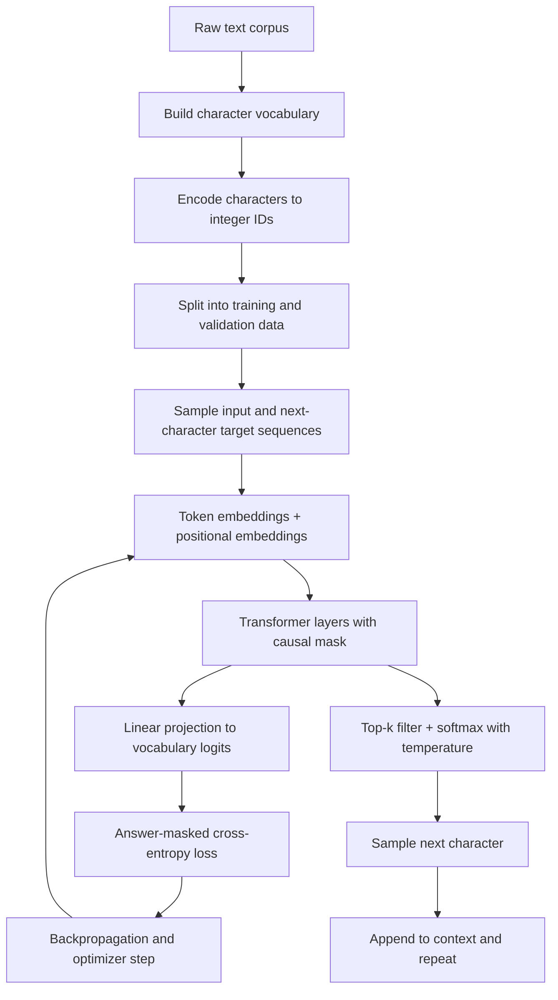

# TinyLLM 

A small GPT-style language model built from scratch in PyTorch. It is trained on a small corpus of question-and-answer dialogues and generates text one character at a time.

TinyLLM is a learning and experimentation project. It imitates the shape of a conversation in its training data, but it is not a production LLM and not a real assistant: it predicts the next character of a text, nothing more.

## Table of Contents

- [Overview](#overview)
- [Quick Start: Better Results](#quick-start-better-results)
- [Architecture](#architecture)
- [Model Configuration](#model-configuration)
- [Dataset](#dataset)
- [Training](#training)
- [Text Generation CLI](#text-generation-cli)
- [Results and Limitations](#results-and-limitations)
- [Checkpoint](#checkpoint)
- [Project Structure](#project-structure)
- [Technologies](#technologies)
- [Roadmap](#roadmap)
- [License and Acknowledgements](#license-and-acknowledgements)

## Overview

The model learns statistical patterns in a text corpus by repeatedly predicting the next character given the characters before it. After training, it can continue a prompt by sampling one character at a time, feeding each new character back in as context.

What the project contains:

- Character-level tokenization with a vocabulary built from the training text.
- Token and positional embeddings.
- A Transformer stack with a causal attention mask.
- Answer-masked loss: the model is only scored on the `TinyLLM:` reply, not on the `User:` question text.
- A training loop with periodic training and validation loss evaluation, cosine learning-rate decay and gradient clipping.
- A checkpoint holding the weights, vocabulary and model configuration. With `--keep best` it holds the best-validation weights rather than the final ones.
- A terminal CLI that streams generated replies character by character, with temperature and top-k sampling.

## Quick Start: Better Results

These two commands are the recommended path if you want better output than the defaults produce. Run them in order from the project root:

```powershell
# Train longer, regularize with dropout, and keep the best-validation weights
uv run python trainer/train.py --iters 12000 --dropout 0.1 --keep best

# Test the saved checkpoint with a sharper, more focused sampling distribution
uv run python tests/testllm.py --temperature 0.2
```

Why this combination:

- `--iters 12000` runs 50% more optimizer steps than the default 8000, giving the cosine learning-rate schedule more room to bring the loss down before it ends.
- `--dropout 0.1` randomly zeroes activations during training. It slows memorization of the training dialogues and usually lowers validation loss relative to a dropout-free run.
- `--keep best` saves the weights from the step with the lowest validation loss. The default, `--keep last`, saves whatever the final step produced, which is often past the point where validation loss started rising.
- `--temperature 0.2` sharpens the next-character distribution. With top-k sampling already limiting the choice to the 10 most likely characters, a low temperature produces steadier, more readable replies. Raise it to `0.5` or `0.8` if you want more variety.

See [Training](#training) and [Text Generation CLI](#text-generation-cli) for all options and for how to read the loss numbers. The test command starts interactive mode; add `--prompt "your question"` to generate one answer and exit.

## Architecture

### Data flow



The upper half is training. The lower branch is generation from a trained checkpoint.

### Why a Transformer encoder with a causal mask

The model is built on PyTorch's `nn.TransformerEncoder` rather than a dedicated GPT decoder class. An encoder layer is self-attention plus a feed-forward block, which is exactly the body of a GPT-style model. On its own, though, an encoder lets every position attend to every other position, including future ones. That would let the model cheat at next-character prediction.

The causal mask fixes this: position *t* may only attend to positions up to *t*. With the mask applied, the computation is autoregressive and behaves like a GPT decoder. Without it, it would not.

### Components

| Component | Purpose |
| --- | --- |
| Token embeddings | Map each character ID to a learned vector. |
| Positional embeddings | Give the model information about order, since attention alone has no notion of position. |
| Multi-head self-attention | Lets each position gather information from earlier positions; multiple heads can focus on different patterns at once. |
| Feed-forward layers | Per-position nonlinear transformation that adds capacity after attention. |
| Residual connections and layer normalization | Built into PyTorch's Transformer encoder layer; they stabilize training of stacked layers. |
| Dropout | Randomly zeroes activations during training to reduce overfitting. Disabled at inference. |
| Causal mask | Blocks attention to future positions so training matches generation. |
| Output projection | Linear layer turning each hidden state into one logit per vocabulary character. |
| Cross-entropy loss | Measures how much probability the model assigned to the true next character. Lower is better. |

## Model Configuration

| Parameter | Default | Description |
| --- | ---: | --- |
| Vocabulary size | 86 | Derived from the training text, not a fixed setting. |
| Embedding dimension | 256 | Width of every hidden representation (`--n-embd`). |
| Attention heads | 8 | Parallel attention subspaces (`--n-heads`). |
| Transformer layers | 6 | Depth of the encoder stack (`--n-layers`). |
| Context length | 128 characters | How many previous characters condition each prediction (`--block-size`). |
| Dropout | 0.0 | Regularization rate (`--dropout`); 0.1 is recommended for longer runs. |
| Parameters | about 633,558 | With the default architecture above and an 86-character vocabulary. |
| Training iterations | 8000 | `--iters`; 12000 is recommended. |
| Batch size | 32 | Sequences per optimizer step (`--batch-size`). |
| Learning rate | 6e-4 | Peak AdamW rate (`--lr`), decayed with a cosine schedule. |

What these control:

- **Embedding dimension** sets the width of every hidden representation. Larger values increase capacity and cost.
- **Heads** split attention into parallel subspaces; the embedding dimension must be divisible by the head count, and training stops with an error if it is not.
- **Layers** set depth. More layers allow more complex patterns but train slower and overfit more easily on small data.
- **Context length** is how many previous characters the model can see. During generation, only the most recent 128 characters condition each prediction.
- **Dropout** trades training fit for regularization. The default is 0.0, so set `--dropout 0.1` explicitly when you want it.

## Dataset

The training corpus is `data/data.txt`, about 398,922 characters containing roughly 3,432 short question-and-answer dialogues. The only other file in `data/` is `data_v1.txt`, an earlier corpus kept for reference; training always reads `data.txt`.

Each example is a dialogue in this shape:

```text
User: Explain a neuron in a neural network
TinyLLM: It is a small unit that takes numbers in, combines them, and passes a number on.
<END>
```

How it becomes training data:

1. Every distinct character in the text becomes a vocabulary entry (86 in total), with mappings from character to ID and back.
2. The whole text is encoded as a sequence of integer IDs.
3. The data is divided into a training portion (first 90%) and a held-out validation portion (last 10%).
4. Training examples are windows of consecutive characters. The target for each position is simply the next character, so the target window is the input window shifted by one.
5. A boolean mask marks the characters from just after `TinyLLM:` to the end of `<END>`. Cross-entropy is averaged only over those characters, so the model spends its capacity learning replies rather than reproducing questions.

Character-level tokenization is simple and well suited to learning exercises, since there is no tokenizer to build. The cost is longer sequences and typically more data required than with subword tokenization.

Even at roughly 400 thousand characters, the corpus is small for a language model. It contains many near-duplicate question patterns, which limits generalization and shows up as repetitive or formulaic answers. Expect the model to reproduce the tone and structure of these dialogues, not to reason.

## Training

Run training from the project root:

```powershell
uv run python trainer/train.py
```

`--help` lists every option. Defaults: 8000 iterations, batch size 32, context 128, 6 encoder layers of width 256, no dropout, and the final weights are saved.

### Recommended command

For better results, train longer, regularize, and keep the best-validation checkpoint instead of the last one:

```powershell
uv run python trainer/train.py --iters 12000 --dropout 0.1 --keep best
```

What each flag changes:

- `--iters 12000` gives the model about 50% more optimizer steps than the default 8000. The default 8000-step cosine schedule can end while loss is still falling, so 12000 gives training more room.
- `--dropout 0.1` applies dropout inside attention and the feed-forward blocks. The corpus is small enough that the model starts memorizing early; dropout typically improves validation loss relative to a dropout-free run of the same length.
- `--keep best` overwrites `model/mini_gpt.pt` every time validation loss reaches a new low, so the checkpoint you test with is the best-generalizing model rather than the final one. With the default, `--keep last`, only the last step is saved. Under `--keep best` a checkpoint is written at the very first evaluation (step 1), because any finite loss beats the initial infinity, so even an interrupted run leaves a usable file.

Expect a longer run than the defaults; more iterations and dropout both cost time.

### Options

| Option | Default | Description |
| --- | ---: | --- |
| `--iters` | 8000 | Number of optimizer steps. |
| `--batch-size` | 32 | Sequences sampled per step. |
| `--block-size` | 128 | Context length in characters. |
| `--eval-interval` | 250 | Steps between train and validation loss estimates. |
| `--lr` | 6e-4 | Peak learning rate, cosine-decayed to 10% of this value. |
| `--n-embd` | 256 | Embedding and hidden width. |
| `--n-heads` | 8 | Attention heads; must divide `--n-embd`. |
| `--n-layers` | 6 | Transformer encoder layers. |
| `--dropout` | 0.0 | Dropout rate; use `0.1` for longer runs. |
| `--keep` | `last` | `last` saves the final weights, `best` saves the lowest validation loss. |

### Reading the loss

Loss is evaluated on both splits at each `--eval-interval`:

- **Training loss** is the answer-masked cross-entropy on data the model is learning from.
- **Validation loss** is the same metric on held-out text. It is the better indicator of how well the model generalizes.

Because loss is computed only on answer characters, the values are not comparable with character-level loss over the whole text. A model guessing uniformly among 86 characters would score about ln 86 ≈ 4.45 at the start.

A healthy run shows both losses falling quickly at first, then training loss pulling away from validation loss. When validation loss stops improving and starts to rise, the model is overfitting, which is exactly what `--keep best` protects against. Compare runs using the final printed "Best validation answer loss", not the last logged value.

## Text Generation CLI

The CLI loads the saved checkpoint, rebuilds the model from the stored configuration, and generates a reply autoregressively. Your prompt is wrapped as `User: <prompt>` followed by `TinyLLM:`, then the model predicts a distribution over the next character, samples one, appends it to the context, and repeats. Generation stops at `<END>`, at a new `User:` or `TinyLLM:` marker, or at the character limit.

### Recommended command

After training with the recipe above, test with a low temperature:

```powershell
uv run python tests/testllm.py --temperature 0.2
```

Temperature 0.2 suits this checkpoint well: top-k sampling already restricts each step to the 10 most likely characters, and the low temperature makes that shortlist much more decisive. Replies are steadier and more on-topic than at the default 0.6. If output feels too repetitive, try `0.4` or `0.5`; if it still drifts, lower it to `0.1`, or use `--temperature 0` for fully greedy decoding.

Interactive mode:

```powershell
uv run python tests/testllm.py
```

Single prompt:

```powershell
uv run python tests/testllm.py --prompt "What is a neuron?" --temperature 0.2 --tokens 120
```

With options:

```powershell
uv run python tests/testllm.py --prompt "Explain elif" --tokens 200 --temperature 0.2 --top-k 10
```

| Option | Default | Description |
| --- | ---: | --- |
| `--prompt` | none | Starting text. If given, the script generates once and exits. Without it, interactive mode starts. |
| `--tokens` | 200 | Maximum number of new characters to generate. Must be at least 1. |
| `--temperature` | 0.6 | Sampling temperature. Must be 0 or greater; `0` means greedy decoding. |
| `--top-k` | 10 | Sample only from the k most likely characters. `0` disables the filter. |

In interactive mode, type a prompt and press Enter. The same `--tokens`, `--temperature` and `--top-k` values apply to every prompt. Type `q`, `quit`, `e` or `exit` to leave. Ctrl+C interrupts a generation.

The interface uses [Rich](https://github.com/Textualize/rich) for colored output. Generated text is streamed to the terminal one character at a time. The script uses the GPU when CUDA is available in the installed PyTorch build, and the CPU otherwise.

### Temperature and top-k

The model's output logits are divided by the temperature, then filtered to the top k, then passed through the softmax.

- Lower values sharpen the distribution, making output more predictable and repetitive.
- Higher values flatten it, making output more varied and more error-prone.
- `--temperature 0` skips sampling entirely and always picks the most likely character, so output is deterministic for a given prompt.
- `--top-k 0` removes the shortlist and samples from the full vocabulary, which is rarely useful for a character-level model this small.

Temperature changes how the model samples, not what it has learned. It cannot fix a weakly trained model, but with a tiny model it has a large effect on readability.

### Prompt handling

- The prompt is wrapped as `User: <prompt>` and `TinyLLM:` before encoding. Write prompts as questions or requests, matching the training format.
- Characters in the prompt that are not in the training vocabulary are silently dropped.
- If no prompt character is in the vocabulary, nothing is generated and a message is shown.
- Generation stops as soon as `<END>`, `\nUser:` or `\nTinyLLM:` appears, so a reply does not run into a fabricated next question.
- There is no conversation history; every prompt is processed independently.

## Results and Limitations

The model picks up the dialogue format, common question patterns and the style of the answers in its corpus. Expect plausible-looking but shallow replies, malformed words, repetition, and answers that borrow phrasing from unrelated training examples. It has no idea what the words mean.

Limitations:

- Small training corpus (roughly 3,400 short dialogues).
- Character-level tokenization rather than subword tokens.
- Small model (about 634 thousand parameters) and a 128-character context window, which is shorter than many questions plus answers in the corpus.
- Overfitting is easy to trigger; use `--dropout 0.1` and `--keep best` to mitigate it.
- Only a 10% validation split, so validation loss is itself noisy.
- No instruction tuning or reinforcement learning from feedback. It imitates the training answers.
- No retrieval of external knowledge.
- No memory between prompts.
- No guarantee that generated text is factual. Output imitates a question-and-answer style; it is not information you should rely on.

A prompt like "Who are you?" produces an answer shaped like the training replies, but the model is continuing characters, not reasoning about itself.

## Checkpoint

The inference script loads the checkpoint from `MODEL_FILE`, defined in [`trainer/train.py`](trainer/train.py). The expected file is `model/mini_gpt.pt`.

The checkpoint stores:

- `model_state_dict`: the trained weights.
- `config`: the model hyperparameters used to rebuild the architecture.
- `vocab_size`, `stoi` and `itos`: the vocabulary size and the character-to-ID and ID-to-character mappings.

To generate, the CLI constructs `TinyGPT` from `vocab_size` and `config`, loads the weights, and switches the model to evaluation mode, which disables dropout. The checkpoint is loaded with `weights_only=True`.

How the checkpoint was produced matters. With `--keep best`, it holds the weights from the evaluation with the lowest validation loss, which is usually not the final step. With `--keep last`, it holds the final state. Checking the "Best checkpoint saved" lines in the training log tells you which validation loss the file corresponds to.

Training overwrites `model/mini_gpt.pt`. Copy the file elsewhere before a new run if you want to compare checkpoints side by side.

If the checkpoint is missing, the CLI exits with a message asking you to run training first.

Model files can be large. Depending on your repository policy, consider Git LFS or excluding the checkpoint from version control.

## Project Structure

```text
TinyLLM/
├── data/
│   ├── data.txt          # Training corpus (question/answer dialogues)
│   └── data_v1.txt       # Earlier corpus, not used by training
├── model/
│   └── mini_gpt.pt       # Saved checkpoint (created by training)
├── trainer/
│   ├── __init__.py
│   └── train.py          # Model definition, data prep, training loop
├── tests/
│   └── testllm.py        # Generation CLI
├── pyproject.toml        # Project and dependency configuration
├── uv.lock               # Locked dependency versions
└── README.md
```

## Technologies

- Python
- PyTorch
- Transformer architecture (`nn.TransformerEncoder` with a causal mask)
- CUDA, optional, depending on the installed PyTorch build
- [uv](https://docs.astral.sh/uv/) for environment and dependency management
- [Rich](https://github.com/Textualize/rich) for the terminal interface

## Roadmap

- [ ] Expand and diversify the training corpus.
- [x] Save and restore the best validation checkpoint (`--keep best`).
- [ ] Add loss curves and training metrics.
- [ ] Expose the training seed as a command-line option (it is currently fixed at 42).
- [ ] Improve checkpoint management and support resuming training.
- [ ] Experiment with subword tokenization.
- [x] Make model and training hyperparameters configurable from the command line.
- [ ] Compare generation quality at different temperatures systematically.
- [ ] Add automated tests for checkpoint loading and text generation.
- [ ] Experiment with larger models and longer context windows.

## License and Acknowledgements

No license has been specified for this project's code yet. Check the repository before redistributing it.

The training text is the dialogue corpus in `data/data.txt`. Its original source and license have not been documented here, so confirm both before redistributing it. `data/data_v1.txt` is an earlier corpus kept for reference and is not read by training.

This project follows the general approach popularized by character-level GPT tutorials, implemented here with PyTorch's built-in Transformer modules.